# 🎯 学考冲刺通 · 信息技术基础

## 📦 两种形态，别搞混

| 形态 | 谁用 | 数据在哪 | 获取 |
|---|---|---|---|
| **🌐 网页版**（本仓库主体） | 学生手机/电脑 + 教师投屏 | 浏览器 localStorage / 云端 KV | [主站](https://xuekao.jiuyeke.cn) · [备用站](https://coral-beacon-g4jx.here.now/) · 离线单文件 `dist/学考冲刺通.html` |
| **💻 Windows 课堂版**（独立客户端 exe） | 教师机+投影，上课 PK/擂台/点名 | 安装目录 `data/`（本地数据库，拷走=备份） | [GitHub Release 下载](../../releases/latest)（当前 Latest `client-v1.1`：免安装 zip 或安装包 exe，二选一） |

> 课堂版特点：默认基础档 1000 题（可切 2000 / 3000 / 全库 3982 题）、离线可用、底部课堂导航（首页/PK/擂台/排行榜/备课夹/点名台）、
> 托盘常驻 + Edge 应用窗口（课/zc logo）、背景音乐（mp3 放 music/ 文件夹）。
> 两者数据互相独立——网页版成绩在云端/浏览器，课堂版战绩在安装目录，互不影响。

## 🚀 直接在线使用（无需安装）

| 入口 | 网址 | 用途 |
|---|---|---|
| **☁️ 云端主站（推荐）** | **https://xuekao.jiuyeke.cn** | 学生手机/电脑直接打开，输学号+班级码刷题，成绩实时上云；老师看全班学情 |
| **🌐 长期备用站（here.now）** | **https://coral-beacon-g4jx.here.now/** | 与主站同代码同步更新，**永久有效（expiresAt=null）**，已登记在 here-now 账户「学考冲刺通」文件夹 |
| 🌐 备用站（here.now） | https://coral-beacon-g4jx.here.now/ | 同一份单文件前端，本机档案模式，双击级备用 |
| 📱 学生扫码 | `evidence/qr-xuekao-cloud.png`（云端）/ `evidence/qr-xuekao.png`（备用站） | 打印贴周测卷角落即可 |

> 云端主站班级码向授课老师索取；教师学情页需教师密钥（密钥只存部署者本机，不在此仓库）。

> 🤝 **接手维护？** 见 [HANDOFF.md](HANDOFF.md)（完整交接提示词：环境、铁律、任务清单）

## 📸 界面一览

### 学考冲刺通（学生端）

| 首页（预估分 + 打卡 + 提分曲线） | 答题页（完整辨析 + 难度徽章） |
|---|---|
| 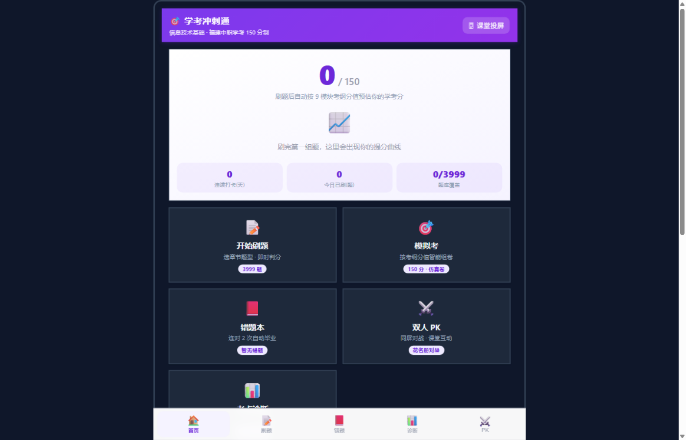 | 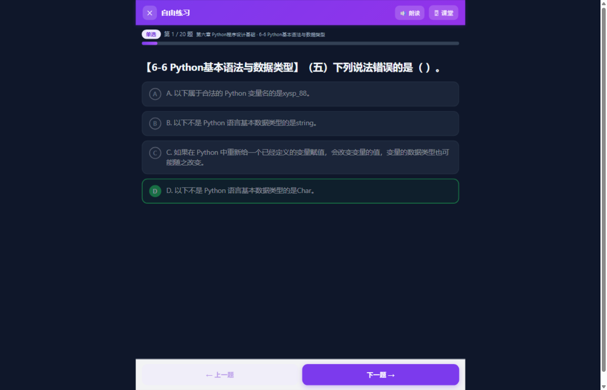 |
| **考点诊断（雷达图 + 薄弱考点）** | **错题本（连对 2 次毕业）** |
| 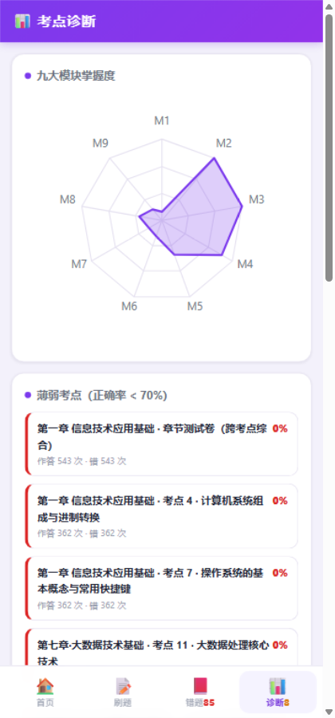 | 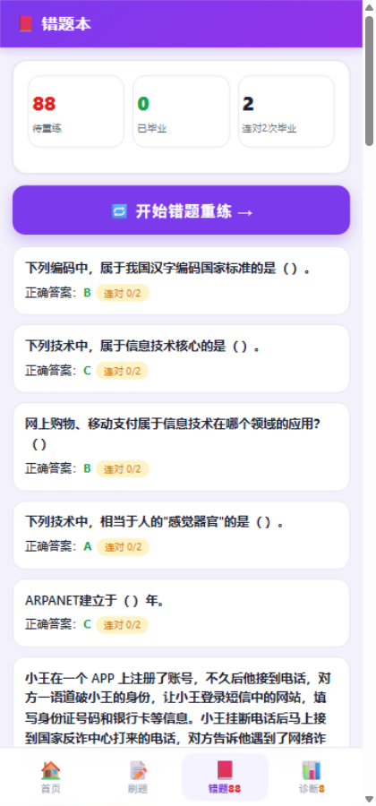 |
| **课堂互动（点名/音效/多音色朗读）** | **班级学情（教师端）** |
| 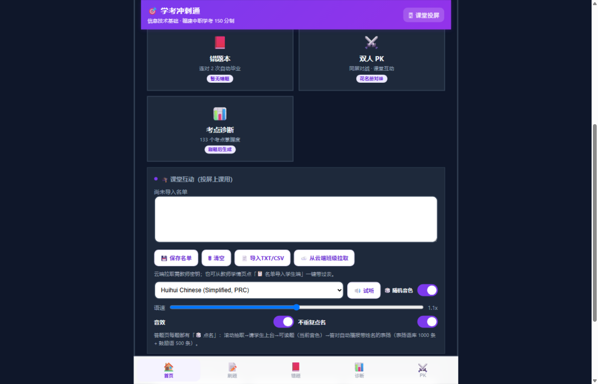 |  |

### ⚔️ 双人课堂 PK（已合并进主程序，底部 PK 页签）

手动选人或点「🎲 随机匹配」当场抽两人（TTS 念名字请上台对战）；顶部领先条独立居中一行大字显示当前领先者；开赛设置里「③ 出题章节」九格点一下即生效（默认全勾 = 整个题库，并在旁边常驻「已选 N 章 · 可抽 X 题」）；答对答错播报带姓名表扬语与鼓励语。投屏时 PK 页自动全宽、左右各占半屏、中间一条分割线，开赛后还会折叠「选人」那一行把 53px 还给题面（实测面板 508→561px、随机题中位字号 23px、一屏装不下需滚动的题 0）。

| 双人对战（分屏独立答题） | 比赛结果（胜负 + 错题复盘） |
|---|---|
| 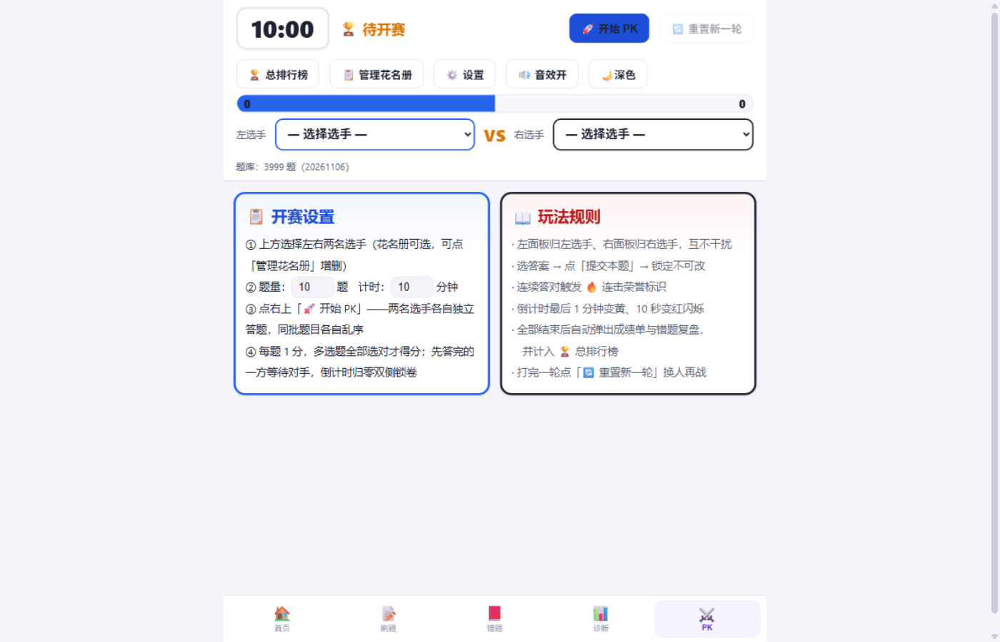 | 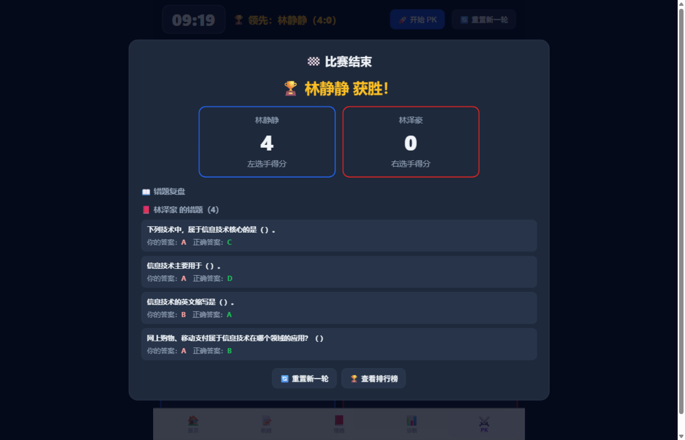 |
| **总排行榜（参赛/胜场/总分/均分）** |  |
| 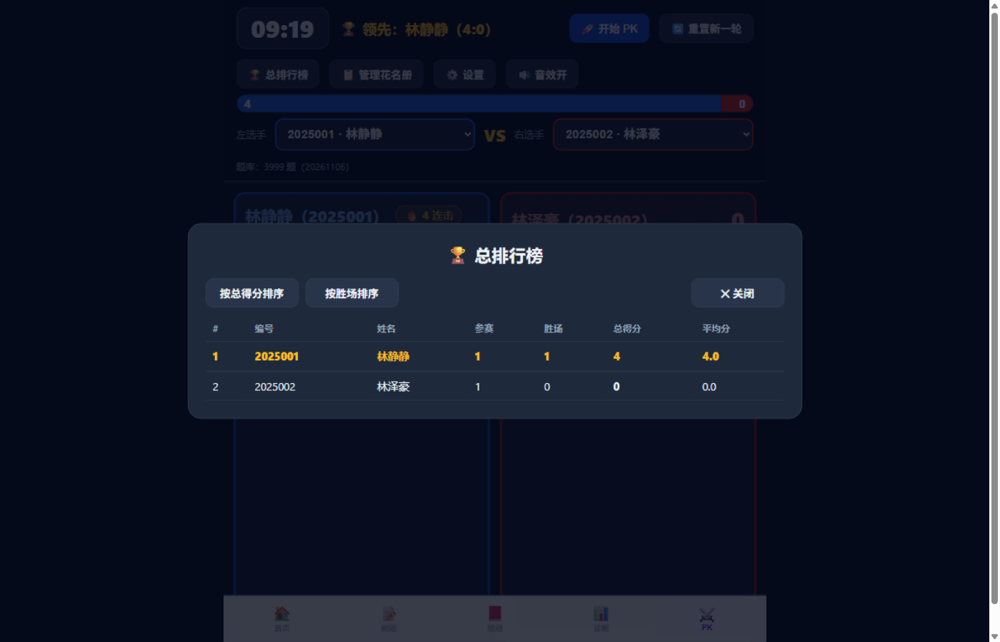 |  |

### 🥊 擂台赛（首页「擂台赛」卡，投屏专用）

一人守擂、全班轮流踢馆：第一场两人争擂主，胜者坐上擂主位，之后每场只点一位挑战者上台；
平局算擂主守住、连胜继续加，被打下台就换人坐庄。打满设定场次自动结算，列出最终擂主、
每人上场与胜负、以及**本节没上过台的同学**（下一轮优先安排）。候选席一屏 3 张卡片，
本轮没上过台的一律不重复；也可以点「🎲 直接随机」。为免和双人 PK 看错，擂台是**另一套界面**：
朱红/墨黑/麦金配色、42%+58% 不对称席位（擂主卡刻意窄一档，但实测仍保证中位 21px 起）、主操作在底部、播报是固定男声 + 擂台口吻文案，
战绩也只写 `pk.arena.*`，不碰双人 PK 的排行榜。

| 第一场争擂（两人抢擂主位） | 守擂中（擂主已定，等下一位踢馆） |
|---|---|
| 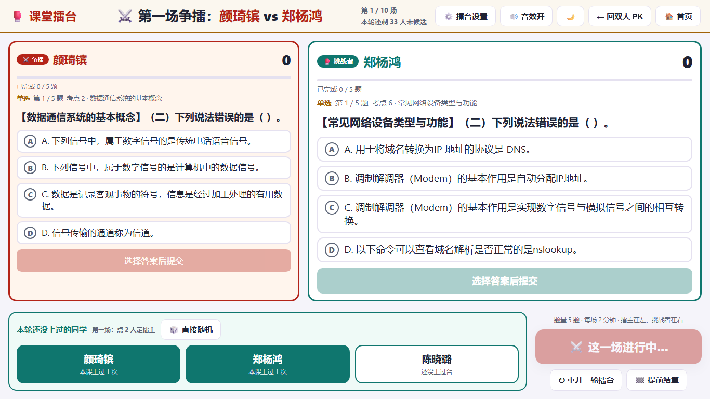 | 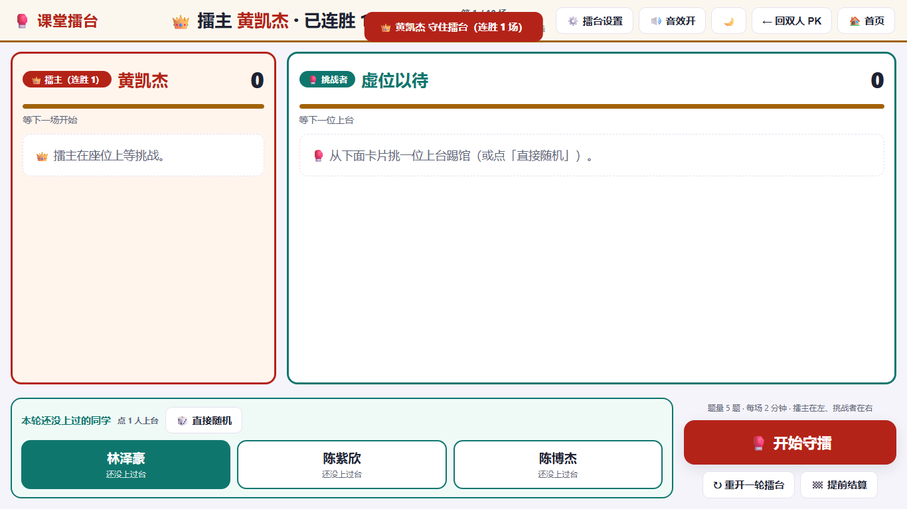 |
| **擂台告示（最终擂主 + 每人胜负 + 没上过台名单）** |  |
| 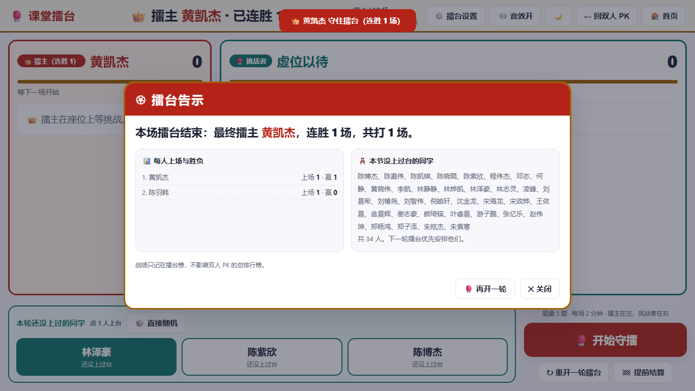 |  |

> 投屏（≥901px）时 PK 与擂台都不显示底部页签，把 65px 全部还给题面，退出走顶栏「🏠 首页」。

## 功能

- **150 分制预估分**：按 9 大模块考纲分值（15/15/15/7/30/30/15/8/15）加权各模块正确率，练得越多越准；提分曲线记录每次成绩
- **错题本**：错题自动进本，连对 2 次自动毕业，再错回本
- **考点诊断**：九模块雷达图 + 133 个「模块×考点」掌握度 + 薄弱考点 TOP（正确率 <70%）+ 一键弱项特训（智能组题 50 题）
- **模拟考**：按考纲分值精确组卷 150 题（每题 1 分，累进分配保证总数精确），交卷出分
- **朗读**：题干+选项中文语音朗读（Web Speech API）
- **课堂投屏**：右上「🖥 课堂」按钮，PC 横屏大字号 + 选项双列，教室后排可读
- **课堂互动两套**：⚔️ 双人 PK（同屏对战、总排行榜）与 🥊 擂台赛（一人守擂、全班轮流踢馆、结算点名没上过台的人）；数据与界面互相隔离，方案见 `docs/擂台赛-开发方案.md`
- **深色/浅色主题**：右上角一键切换（默认浅色），全站（含 PK 模块）统一配色，选择记忆在本机
- **班级版教师端**：全班榜单（预估分/覆盖/今日/待重练错题/最后活跃）+ CSV 导出（Excel 双击即开）

题库：**3982 题**（3999 - 17 道同题双版本去重），每题带解析、生活类比、易错提醒，按 2026 考纲 9 模块组织。

> **题量档位（2026-11-10 起）**：全端默认 **基础档 1000 题**；教师可在首页底部「学习档案」下方的「教师选项 · 题量档位」卡片（或 PK 设置弹窗）切到 **高级档 2000 题 / 终极档 3000 题 / 全库 3982 题**。三档白名单严格嵌套（1000 ⊂ 2000 ⊂ 3000），升档不会丢掉做过的题；按考纲分值 + 58 个考点配平，**且只从三态判定为 KEEP 的干净池（3347 题）抽取**——DELETE 596 题、CLEAN 39 题、84 道跨考点综合卷、15 道跨模块错挂题均已排除，三档题池**零坏题**（`src/build.js` 构建时硬校验，含 DELETE 题直接构建失败）。1000/2000 档严格按分值配额；3000 档受干净题容量约束（M5 592、M6 559、M7 279，缺口由其它模块补足，偏差记录在白名单 JSON 的 `module_quota_adjusted`）。题库真源一题未删、qid 不变，学生档案零断链。按钮不放在顶栏，避免课堂上误点；`/api/bank` 默认返回 1000 题，`?tier=2000|3000` 切档、`?full=1` 给全库。白名单见 `docs/白名单-{1000,2000,3000}题.json`，配额见 `docs/题库精简配额-2000题.csv`。

> **教师修正题目**：答题页题号旁「✏️ 修正本题」→ 输入教师密码 → 模态框内可改题干、选项、正确答案、解析；保存立即生效，可「恢复原题」或导出 / 导入修正 JSON。修正按原 qid 存本机 `localStorage`，**改题干不改 qid**，学生档案零断链；不自动同步其它设备，换设备用导出 / 导入。实现见 `src/question-override.js`。
>
> **教师删除题目**：旁边「🗑 删除本题」→ **每次打开都要重输教师密码** → 解锁后显示题目预览 + 二次确认；弹窗下方「已删除题目」清单可**逐条恢复**，也支持导出 / 导入清单。删除是**本机隐藏标记**（按原 qid 存 `localStorage['xkc.qdeleted.v1']`），只过滤题池视图，`BANK_ALL` 一个字节不动（三档白名单存的是它的下标），真源一题不删、qid 不变；本次练习立即跳过该题，刷新后仍生效。不自动同步其它设备，换设备用导出 / 导入。实现见 `src/question-override.js` 的 `XK_QDEL`。
>
> **题库质检工具**：`docs/题目逐题审阅.html`（离线单文件，内嵌全库 3982 题）一题一屏依次展示、带全局编号与 qid，按 `P` 进纯净模式即可逐题截屏给审查 AI；`docs/AI审题提示词.md` 是配套提示词。把 AI 返回的 `DELETE` 结果粘回审阅页，即可导出主程序可直接导入的删除清单（本机隐藏、可恢复）。生成器 `node tools/build-review.js` 可随题库更新重跑；全库三态预检 **DELETE 596 / CLEAN 39 / KEEP 3347**（R1~R9），可勾选「只看可疑题」只筛 DELETE。
>
> **判定规则单一真源**在 `tools/quality-rules.js`（R1~R8，三态 `DELETE/CLEAN/KEEP`），质检器与审阅页共用，禁止各自复制正则。只读质检器 `node tools/quality-gate.js` → `docs/题库质检报告.json`（含按生成批次的污染率、各档白名单污染数、模块配额可行性、完整 DELETE qid 清单）。给 AI 的主方案提示词是 `docs/AI质检规则提示词.md`（v2：让 AI **产出可编码规则 + 反例**，而不是逐题给结论）；`docs/AI审题提示词.md`（v1）只用于少量待复核题。**接下来要做的 5 件事**整理成 `docs/AI下一步任务书.md`（模块专项抽查 / 跨模块事实一致性 / CLEAN 救回 / R9 反例 / 3000 档缺口），可直接复制给执行 AI。

| 首页（预估分 + 打卡） | 班级版教师学情页 |
|---|---|
| 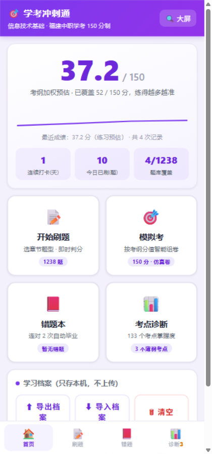 | 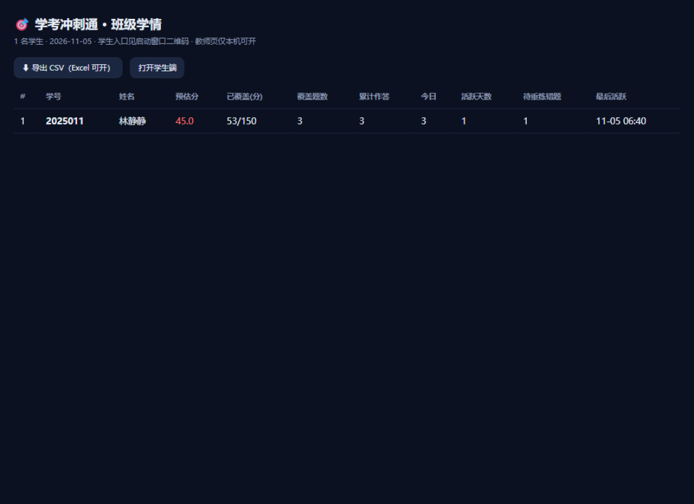 |

## 快速开始

### 学生（单文件 / 线上）
双击 `学考冲刺通.html` 或扫码打开线上版 → 开始刷题。档案自动保存在本机浏览器；
换设备用「⬆ 导出档案 / ⬇ 导入档案」。

### 教师（班级版，教室局域网）
```bat
:: Windows 双击 启动班级版.bat，或：
python 班级版服务.py
```
1. 启动后自动生成「学生入口二维码」（需学生手机连**同一 WiFi**）
2. 学生扫码 → 输学号姓名 → 刷题，每次交卷自动同步到老师电脑 `data/学号.json`
3. 老师在本机打开 `http://127.0.0.1:8953/teacher` 看全班学情，可导出 CSV
4. **安全边界**：服务只在本机+局域网，不上公网；教师页/CSV 导出仅限老师电脑本机打开；学生只够得着学生页和自己的档案上传

依赖：Python 3.8+（仅标准库）；可选 `pip install qrcode` 自动生成入口二维码。
缺失前端文件时先执行 `node src/build.js` 生成 `site/index.html`。

## 云端版（Cloudflare Workers + KV/D1）

**入口：https://xuekao.jiuyeke.cn** —— 学生手机直接打开（或扫 evidence/qr-xuekao-cloud.png），
输学号 + 班级码，成绩实时存入云端，老师随时随地看全班学情。

| 角色 | 用法 |
|---|---|
| 学生 | 打开入口 → 输学号、姓名、**班级码** → 刷题，每次交卷自动同步 |
| 老师 | 打开 `https://xuekao.jiuyeke.cn/teacher?key=<教师密钥>` 看榜单 / 导出 CSV（密钥在部署者本地 cloud/keys.json，不入库） |

防滥用：班级码是同步的必备口令（错码 401）；教师页与导出必须带密钥（403）；
学号走白名单校验（防路径注入）；多设备同号自动合并（逐题取 max 防倒退）。

### 双存储支持（同一份 worker.js）

| 配置 | 账户 | 存储 | 入口 |
|---|---|---|---|
| `wrangler.toml`（主站） | zcstudy | **KV** | https://xuekao.jiuyeke.cn（自定义域，国内稳定） |
| `wrangler.d1.toml`（备用） | zcvoice | **D1** | https://xuekao.zcvoice-app.workers.dev（国内可达性不稳定） |

> 为什么主站用 KV：该账户 D1 配额已满且不宜删除既有库；KV 完全覆盖「按学号读写 JSON」的场景。
> D1 版已完整部署可用，换存储只是换 wrangler 配置。

### 部署/更新

```bash
node src/build.js && cp dist/学考冲刺通.html site/index.html   # 前端有改动时
cd cloud
npx wrangler deploy            # 主站（KV + 自定义域，用 zcstudy OAuth）
npx wrangler secret put CLASS_CODE    # 班级码（已设）
npx wrangler secret put TEACHER_KEY   # 教师密钥（已设）

# D1 备用版：
source ~/.cloudflare/zcvoice.env && export CLOUDFLARE_ACCOUNT_ID CLOUDFLARE_API_TOKEN
npx wrangler deploy -c wrangler.d1.toml
```

测试：`node cloud/worker.test.js`（20 项：sid 白名单/合并/预估对账）。

## 构建与测试

```bash
node tests/engine.test.js        # 前端引擎 40 项单测（判分/预估分对账/毕业规则/脏档案清洗/题干清洗）
node tests/pk-pick.test.js       # PK 选人 11 项单测（下拉能选中姓名/左右互斥/选人后可开赛）
node tests/pk-features.test.js   # PK 功能 42 项单测（领先条/随机匹配/章节过滤/抽题真随机/带姓名表扬语/一屏自适应）
python tests/test_server_logic.py  # 班级版服务 38 项单测（学号白名单/档案合并/榜单统计）
node tools/scan-defects.js       # 题库四类缺陷复扫 + 基线对比（计数上升即失败）
node src/build.js                # 构建：内嵌 engine+data+app+css → dist/学考冲刺通.html
node src/deploy.js site <slug>   # 部署到 here.now（需 ~/.herenow/credentials）
```

零第三方依赖（Node ≥18 / Python ≥3.8 标准库）。

## 目录结构

```
src/engine.js      纯逻辑引擎（无 DOM，Node 可测）：判分、预估分、错题毕业、弱项诊断、组卷、档案校验
src/app.js         界面层：面板切换、localStorage 档案、朗读、导出导入、班级同步（渐进增强）
src/style.css      移动优先样式 + 课堂投屏模式
src/data.js        题库（1238 题，BANK/BANK_META 两个全局变量）
src/build.js       构建脚本（内嵌四文件，构建期校验题目 ID 唯一、考纲总分 150）
src/deploy.js      here.now 部署脚本
tests/             上述全部单测
site/index.html    构建产物（班级版服务直接伺服它）
班级版服务.py       班级版：HTTP 服务 + 档案合并 + 教师榜单（仅标准库）
启动班级版.bat      Windows 双击入口
evidence/          构建时的测试记录与截图
```

## 题库更新

用新版 `data.js` 覆盖 `src/data.js` → `node src/build.js` → 跑两个测试 → 复制到 `site/`。

**注意**：题目 ID = `djb2(模块|题型|题干)`，题干参与计算。已发布过的题**不要改题干**，
否则学生端旧档案里的作答记录会对不上号（选项/解析随便改）。

## 设计取舍

- **不做云端账号**：与本地优先的隐私哲学一致；班级场景用「局域网 + 学号」解决长久记录，
  自学场景用「本机档案 + JSON 导出导入」解决迁移。前端通过探测 `/api/hello` 渐进增强：
  有班级版服务就同步，没有就静默本机模式——同一份前端代码三处通用
- **档案合并**：多设备同账号逐题取 max（宽松策略防互相倒退）；前端导入档案走白名单校验+数值钳制，
  脏 JSON 不会搞崩页面，也防误导入清空
- **模拟卷组额**：按模块考纲分值配额、累进分配取整，保证总题数精确 150（半卷精确 75）

## 题库版权

`src/data.js` 题库内容版权归作者所有，仅供学习交流，未经许可不得商用或转载。

---
*作者：openclawzhangchong · 由 ZCode 全自主 agent 于 2026-11 构建与测试*
